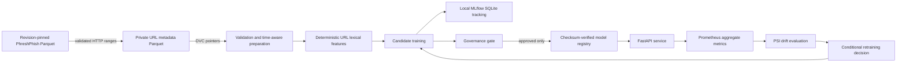

# AdaptivePhish architecture

The dataset URLs are inert strings: the project never resolves or visits them.
Raw URL records and model artifacts are excluded from Git. Git holds source,
configuration, documentation, and DVC pointers. A DVC remote remains required
for cross-machine data retrieval.
